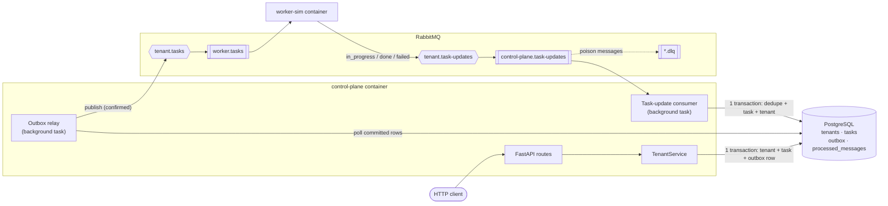
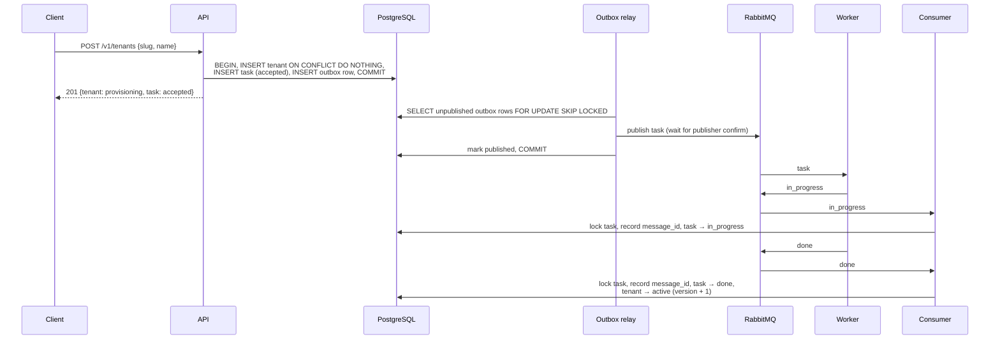

# Tenant Provisioning Control Plane

A control plane that records tenants and drives their asynchronous lifecycle
(`deploy` → `update` → `destroy`) through tasks that a worker executes over a message broker.

**Stack:** Python 3.13 · FastAPI · PostgreSQL 16 (SQLAlchemy 2 async + Alembic) · RabbitMQ 4 (aio-pika) · Docker Compose

---

## Setup

Requirements: Docker (Desktop or Engine, with Compose v2, running), `make`, `curl`.
The command runner is `make`. Everything else (PostgreSQL, RabbitMQ, migrations, the API and
the worker) runs in containers started by the boot command.

```bash
git clone https://github.com/chandra-nil-tech/tenant-control-plane.git && cd tenant-control-plane
make up      # single command: builds & boots everything, waits until the API is ready
make test    # single command: runs the full test suite (in Docker, on its own postgres + rabbitmq)
```

`make check` runs every quality gate (format, lint, types, security scan, tests + coverage).
`make help` lists all commands.

### Watch a tenant walk its lifecycle

After `make up`, no manual steps are needed: the worker simulator picks up the task by itself.

```bash
make demo    # creates a tenant and polls it until it is active
```

Or with plain `curl`:

```bash
curl -s -X POST localhost:8000/v1/tenants -H 'content-type: application/json' \
  -d '{"slug": "acme-corp", "name": "Acme Corp"}'
# -> 201: tenant "provisioning" (version 1), task "deploy" "accepted". Copy the two ids.

curl -s localhost:8000/v1/tenants/<tenant_id>          # provisioning -> active (version 2)
curl -s localhost:8000/v1/tenants/<tenant_id>/tasks    # deploy: accepted -> in_progress -> done
curl -s localhost:8000/v1/tasks/<task_id>              # the same task on its own
```

By default each worker step takes 0.5–2 s. To watch `in_progress` comfortably, run
`make worker-slow` first (5–10 s per step) and `make worker-reset` afterwards.

- API docs (OpenAPI, try every endpoint in the browser): http://localhost:8000/docs
- RabbitMQ UI: http://localhost:15672 (guest / guest)

`make down` stops the stack and keeps the data; `make clean` also deletes it.

---

## Architecture



| Layer | Responsibility | Code |
|---|---|---|
| Domain | Enums, the two state machines as transition tables, domain errors. Pure Python. | `src/control_plane/domain/` |
| Repositories | All SQL: atomic conditional updates, `ON CONFLICT`, row locks. | `src/control_plane/repositories/` |
| Services | Use cases, one DB transaction each. They never talk to the broker. | `src/control_plane/services/` |
| API | Routes, request/response schemas, error mapping, request-id middleware. | `src/control_plane/api/` |
| Messaging | Message schemas, topology, outbox relay, consumer, wiring. | `src/control_plane/messaging/` |
| Worker simulator | Consumes tasks, sleeps, reports progress. | `src/worker_sim/` |

### Lifecycle of a create



---

## API

All routes are under `/v1`. Timestamps are ISO 8601 with milliseconds and a `Z` suffix.

| Method | Path | Success | Description |
|---|---|---|---|
| `POST` | `/v1/tenants` | `201` + `Location` | Create a tenant (`provisioning`) and a `deploy` task |
| `GET` | `/v1/tenants` | `200` | List tenants: `?status=`, `?limit=` (1–200, default 50), `?offset=` |
| `GET` | `/v1/tenants/{id}` | `200` | Get one tenant |
| `PATCH` | `/v1/tenants/{id}` | `202` | Partial update of `name`. Requires `version`. Only from `active`; moves the tenant to `updating` and creates an `update` task |
| `DELETE` | `/v1/tenants/{id}` | `202` | Only from `active` or `failed`; moves the tenant to `destroying` and creates a `destroy` task. The tenant row stays, ending as `destroyed` |
| `GET` | `/v1/tenants/{id}/tasks` | `200` | Tasks of one tenant: `?status=`, `?type=`, `?limit=`, `?offset=` |
| `GET` | `/v1/tasks` | `200` | All tasks: `?status=`, `?type=`, `?limit=`, `?offset=` |
| `GET` | `/v1/tasks/{id}` | `200` | One task |

Mutating calls return `{"tenant": {...}, "task": {...}}`, so the client gets the id of the task
to track. `PATCH` and `DELETE` answer `202 Accepted` because the work is asynchronous. List
responses are `{"items": [...], "limit": 50, "offset": 0}`, newest first.

### Examples

```bash
# create
curl -s -X POST localhost:8000/v1/tenants -H 'content-type: application/json' \
  -d '{"slug": "acme-corp", "name": "Acme Corp"}'
# -> 201 {"tenant": {"id": "…", "slug": "acme-corp", "status": "provisioning", "version": 1, …},
#         "task":   {"id": "…", "type": "deploy", "status": "accepted", …}}

# the worker drives it to active
curl -s localhost:8000/v1/tenants/<tenant_id>            # status: active, version: 2
curl -s localhost:8000/v1/tenants/<tenant_id>/tasks      # deploy: done

# update: send the version you read (optimistic locking)
curl -s -X PATCH localhost:8000/v1/tenants/<tenant_id> -H 'content-type: application/json' \
  -d '{"version": 2, "name": "Acme Inc"}'                 # 202, status: updating, version: 3

# a stale version
curl -s -X PATCH localhost:8000/v1/tenants/<tenant_id> -H 'content-type: application/json' \
  -d '{"version": 2, "name": "Again"}'
# -> 409 {"error": {"code": "tenant_version_conflict", "message": "version 2 is stale; current version is 4", …}}

# delete
curl -s -X DELETE localhost:8000/v1/tenants/<tenant_id>  # 202, destroying → destroyed

# list with filters
curl -s 'localhost:8000/v1/tasks?status=failed&type=deploy&limit=20'
```

### Errors

Every error has the same body, so a client can branch on `error.code`:

```json
{"error": {"code": "tenant_not_found", "message": "tenant … not found",
           "details": {"tenant_id": "…"}, "request_id": "3c10…"}}
```

| HTTP | `code` | When |
|---|---|---|
| 404 | `tenant_not_found` | Unknown tenant id |
| 404 | `task_not_found` | Unknown task id |
| 404 / 405 | `not_found` / `method_not_allowed` | Unknown route / wrong method |
| 409 | `tenant_already_exists` | Slug taken, including by a `destroyed` tenant |
| 409 | `tenant_update_not_allowed` | The tenant's status forbids this PATCH or DELETE |
| 409 | `tenant_version_conflict` | PATCH `version` is stale (`details.current_version`) |
| 422 | `validation_error` | Invalid body or query (`details.errors[]`) |
| 500 | `internal_error` | Unexpected error. The stack trace goes to the logs, never into the response |

If a PATCH has both a stale version and a forbidden status, the status error wins:
refreshing the version wouldn't make the request succeed.

---

## Messaging

| Direction | Exchange (topic) | Routing key | Queue |
|---|---|---|---|
| control plane → worker | `tenant.tasks` | `task.<type>` | `worker.tasks` |
| worker → control plane | `tenant.task-updates` | `task_update.<status>` | `control-plane.task-updates` |
| dead letters | `tenant.dlx` (direct) | `<queue>.dlq` | `worker.tasks.dlq`, `control-plane.task-updates.dlq` |

Queues are durable quorum queues with `x-delivery-limit: 5`. Messages are persistent, and every
publish waits for a publisher confirm.

**Outbound: the task is the event.** The payload is the task, and the AMQP `message_id` is the task id.

```json
{"id": "b0ac…", "type": "deploy", "tenant_id": "f2e0…", "status": "accepted",
 "created_at": "2026-11-21T13:02:13.992Z"}
```

**Inbound: a progress update.** `message_id` is the idempotency key; `task_id` references the task.

```json
{"message_id": "087d10f9-…", "task_id": "b0ac…", "status": "in_progress | done | failed"}
```

The simulator sets `message_id = uuid5(namespace, "<task_id>:<status>")`. Because it is
deterministic, if a task is redelivered and processed again, the re-sent updates carry the same
ids and are recognised as duplicates.

### How each requirement is met

| Requirement | Mechanism |
|---|---|
| Publish only **after** a durable commit, never on rollback | Transactional outbox: the event row commits in the same transaction as the change, and the relay only sees committed rows |
| Exactly one event per state-changing call | One outbox row per call. Delivery is at-least-once: if the relay crashes after the broker confirm, the event is sent again, and consumers dedupe on the task id |
| Consumer **idempotent** | `processed_messages` (primary key `message_id`), written in the same transaction as the update. A repeat is a no-op and is acked |
| Consumer **order-tolerant** | The task row is locked and status only moves forward (`accepted < in_progress < done/failed`). Terminal tasks never change. A stale update is acked and ignored |
| Transient broker failures retried with backoff | Connecting uses exponential backoff with jitter; `connect_robust` reconnects automatically; the relay backs off while publishing fails, and events wait in the outbox |
| Poison messages don't kill the consumer | Invalid schema or unknown task → rejected to the DLQ. An unexpected error → requeued, and after 5 attempts the broker dead-letters it |
| At most one open task per tenant | Follows from the status guards: an API mutation is only allowed from `active`/`failed`, and moves the tenant into a busy state that only a terminal task outcome leaves |
| Concurrent creates with the same slug: exactly one wins | `INSERT … ON CONFLICT (slug) DO NOTHING`; the loser gets `tenant_already_exists` |
| Two simultaneous PATCHes with the same version: only one wins | A single atomic `UPDATE … WHERE status IN (…) AND version = :v`; the second matches 0 rows |

---

## Reproducing negative scenarios

### Restarting the worker with different settings

The worker takes CLI args, each with an env var: `--fail-rate` (`WORKER_FAIL_RATE`),
`--min-delay-ms` / `--max-delay-ms` (`WORKER_MIN_DELAY_MS` / `WORKER_MAX_DELAY_MS`),
`--duplicate-rate` (`WORKER_DUPLICATE_RATE`) and `--out-of-order` (`WORKER_OUT_OF_ORDER`).

```bash
make worker-fail     # every task fails            -> tenant `failed`
make worker-chaos    # every update sent twice, and `done` sent before `in_progress`
make worker-slow     # 5–10 s per step
make worker-reset    # defaults (fail rate 0, 0.5–2 s delays)

# Or with CLI args directly:
docker compose stop worker
docker compose run --rm worker worker-sim --fail-rate=1 --min-delay-ms=100 --max-delay-ms=300
```

After `make worker-chaos` and `make demo`, the tenant still ends `active` with `version: 2`.
`docker compose logs api | grep -E "duplicate|stale"` shows the consumer ignoring the extra
copies.

### Publishing directly to the broker

[`scripts/publish_update.sh`](scripts/publish_update.sh) publishes through RabbitMQ's management
HTTP API, so `curl` is all you need:

```bash
make worker-slow     # keep the real worker out of the way
TASK=$(curl -s -X POST localhost:8000/v1/tenants -H 'content-type: application/json' \
        -d '{"slug":"manual-1","name":"Manual"}' | sed -E 's/.*"task":\{"id":"([^"]+)".*/\1/')

./scripts/publish_update.sh $TASK done m-1          # applied: tenant active, version 2
./scripts/publish_update.sh $TASK done m-1          # duplicate (same message_id): no change
./scripts/publish_update.sh $TASK in_progress m-2   # out of order (in_progress after done): no change
./scripts/publish_update.sh --raw 'not json'        # poison: dead-lettered, consumer keeps running
./scripts/publish_update.sh 00000000-0000-0000-0000-000000000000 done x   # unknown task: dead-lettered

make queues          # control-plane.task-updates.dlq holds the 2 poison messages
```

The RabbitMQ UI works too: Exchanges → `tenant.task-updates` → *Publish message*.

### Concurrency

```bash
make race
# PASS  50 concurrent creates, slug=race-…: {'201': 1, '409 tenant_already_exists': 49}
# PASS  50 concurrent PATCH version=2: {'202': 1, '409 tenant_update_not_allowed': 49}
# PASS  50 concurrent DELETE: {'202': 1, '409 tenant_update_not_allowed': 49}
```

### Persistence

```bash
make restart         # tenants are still there (named Postgres volume)
```

---

## Design decisions and trade-offs

- **Transactional outbox rather than "commit, then publish".** A crash between commit and
  publish would lose the event; publishing first would announce a change that might roll back.
  Writing the event in the same transaction removes both failure modes. The costs are one table,
  a polling loop (events leave within about 0.5 s) and at-least-once delivery, which the
  consumers handle by deduplicating.
- **Guards inside the SQL statement that writes.** Each guard is checked by the same atomic
  `UPDATE … WHERE …` that performs the write. There's no read-then-write gap and no application
  lock. When the update matches 0 rows, a re-read only determines which error to return.
- **State machines as data.** Transitions are tables in `domain/state_machine.py` that mirror
  the spec, so the tests can check every (state, event) pair.
- **Out-of-order arrivals.** If `done` arrives before `in_progress`, `done` is applied and the
  late `in_progress` is ignored. Refusing it would leave the tenant stuck.
- **DELETE keeps the row.** The tenant ends as `destroyed`, because slugs must stay unique
  "including against destroyed tenants".
- **PATCH writes `name` immediately.** The `update` task then applies it to the infrastructure.
- **One container runs the API, the relay and the consumer**, which satisfies "one deployable
  unit". Each part is safe to run as several replicas (`SKIP LOCKED`, row locks, the message-id
  table), so they could be split later.
- **Database clock (`now()`)** for all timestamps: one clock for every process.
- **Out of scope:** authentication, rate limiting, cleanup of old outbox and `processed_messages`
  rows, metrics, and replaying the DLQ.

---

## Testing and quality gates

`make check` runs these in Docker, against a separate throwaway Postgres and RabbitMQ:

1. `ruff format --check`: formatting
2. `ruff check`: lint (including security and async rules)
3. `mypy --strict`: types
4. `bandit`: security scan
5. `pytest --cov`: tests, with coverage required to be at least 85%

| Suite | What it covers |
|---|---|
| `tests/unit/test_state_machine.py` | Every (state, event) pair of both state machines |
| `tests/unit/test_contracts_and_schemas.py` | Slug and name rules, PATCH rules, timestamp format, message validation |
| `tests/unit/test_consumer_policy.py` | Ack, dead-letter or requeue for valid, poison, unknown-task and failing messages |
| `tests/integration/test_tenant_api.py` | Every endpoint, status code and error code; guards from every state; pagination |
| `tests/integration/test_concurrency.py` | 25 simultaneous creates, PATCHes, DELETEs or duplicate deliveries: exactly one wins |
| `tests/integration/test_task_updates.py` | Lifecycle, duplicates, out-of-order and stale updates, failure paths |
| `tests/integration/test_outbox.py` | No event on rollback, uncommitted events invisible, retry on broker failure, no double publish |
| `tests/integration/test_broker_e2e.py` | Through real RabbitMQ: full lifecycle, fail rate 1, duplicates plus reordering, poison messages to the DLQ |

Integration tests use a real PostgreSQL, because row locks, `ON CONFLICT` and `SKIP LOCKED` are
what's being tested. The schema is created by running the Alembic migrations.

---

## Project layout

```
src/control_plane/
  domain/          models.py · state_machine.py · errors.py
  db/              tables.py · session.py
  repositories/    tenants · tasks · outbox · processed_messages
  services/        tenant_service · task_service · task_update_service · events
  messaging/       contracts · rabbitmq · outbox_relay · consumer · runtime
  api/             routes · schemas · errors · middleware · deps
  main.py          app factory and wiring
  config.py        settings from CP_* env vars
  observability.py JSON logging
src/worker_sim/    simulator.py
migrations/        Alembic
tests/             unit/ · integration/
scripts/           check.sh · demo.sh · race_test.py · publish_update.sh · wait-ready.sh
```

The repository contains no secrets. The compose file holds local-development credentials only,
and each one can be overridden with an env var.
